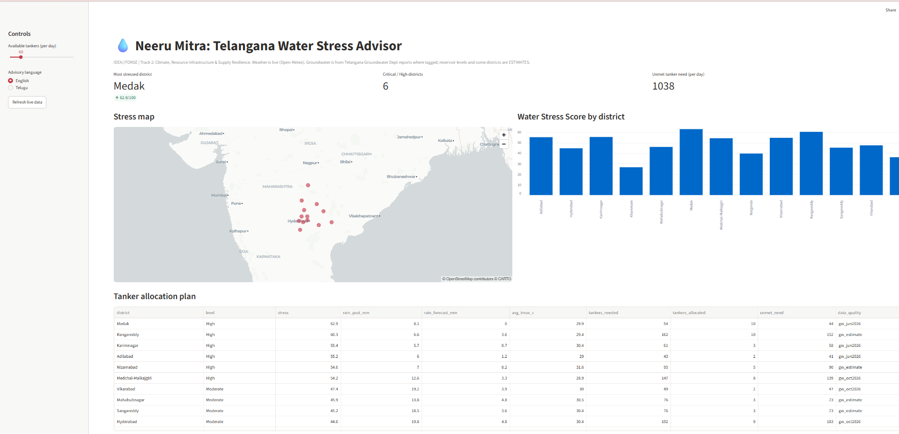

# 💧 Neeru Mitra: Telangana Water Stress Advisor

IDEA//FORGE Online Hackathon | Track 2: Climate, Resource Infrastructure & Global Supply Resilience (Problem 3: Smart Resource Allocation)

**Live app:** [add your Streamlit link here after deployment]



## Problem
[Write 3-4 sentences in your own words. Cover: Telangana's weak monsoon and falling
groundwater this year; that tanker supply is decided mostly by complaints and
protests; that citizens and district officials have no single view of how bad each
district is.]

**Who faces it:** households, hostels, farmers and apartment residents in water-stressed
Telangana districts, and the district and HMWSSB officials who must ration limited
water and tankers.

## Solution
Neeru Mitra is a decision-support dashboard that:
1. Pulls live rainfall and temperature data for 13 districts (Open-Meteo).
2. Combines it with groundwater depth and reservoir level into a **Water Stress Score (0-100)**.
3. **Allocates a limited tanker fleet** across districts by need and stress, with a slider
   for "what if we only have N tankers?"
4. Gives a plain-language **advisory in English or Telugu**.

## How the AI is used
- **Scoring model:** a transparent weighted formula (25% rainfall deficit, 20% heat,
  30% groundwater depth, 25% reservoir shortage). This is rule-based, not a trained ML model.
- **Allocation:** a heuristic that shares tankers in proportion to need x stress, capped at need.
- **Generative AI:** an LLM (Claude, optional) writes the advisory from the computed facts.
  Without an API key, a rule-based advisor produces the English and Telugu text.

## Tech stack
Python, Streamlit, Pandas, Requests, Open-Meteo API, Anthropic Claude API (optional), pytest

## Run locally
```
python -m venv venv
venv\Scripts\activate
python -m pip install -r requirements.txt
python -m streamlit run app.py
```
Optional: copy `.env.example` to `.env` and add an API key for AI-written advisories.

## Data and limitations (please read)
- **Weather:** live, from Open-Meteo.
- **Groundwater depth:** from Telangana Groundwater Department monthly reports as reported
  in the press (October 2026 or June 2026 where tagged `gw_oct2026` / `gw_jun2026`).
  Districts tagged `gw_estimate` use **my own estimates** and should be replaced with
  official figures.
- **Reservoir levels:** estimates, not official district-level data.
- **Population:** approximate Census 2011 values.
- **Tanker demand:** assumes 55 L/person/day and that up to 2% of demand depends on
  tankers at maximum stress. These are adjustable assumptions.
- Press sources consulted: Telangana Today, Deccan Chronicle, Sakshi Post, Daily Pioneer.

## Future work
Official district and mandal-level data feeds, real reservoir levels from India-WRIS,
tanker routing, SMS/WhatsApp alerts, and validation of the scoring weights against
past shortages.

## Credits and originality
- Libraries and services: Streamlit, Pandas, Requests, Open-Meteo, python-dotenv, pytest.
- AI tools: I used an AI assistant (Claude) to help plan and write parts of the code, and
  I reviewed and tested it myself. The optional advisory feature calls the Claude API.
- My earlier project (a river-cleaning bot) is separate. This project was built for
  IDEA//FORGE.